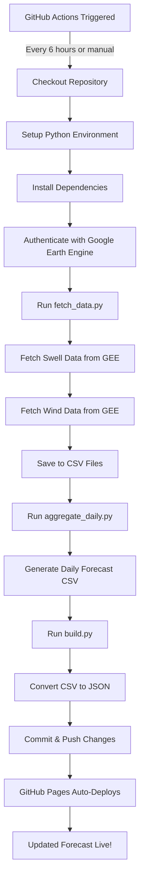

# Surf Forecast - Static Site Generation

A fully automated surf forecast application that fetches real-time ocean data from Google Earth Engine and serves it via GitHub Pages.

## 🌊 Overview

This app uses a **scheduled data pipeline** to automatically fetch, process, and display surf forecasts. All data is pre-generated and stored as static JSON files, eliminating the need for a backend server.

## 🔄 Data Pipeline Workflow

### Automated Pipeline (GitHub Actions)

The entire data refresh process is automated via GitHub Actions and runs **every 6 hours** (00:00, 06:00, 12:00, 18:00 UTC).

#### **What Triggers the Pipeline?**

1. **Scheduled Trigger** - Runs automatically every 6 hours via cron schedule
2. **Manual Trigger** - Can be manually triggered from GitHub Actions UI

#### **Pipeline Steps (Sequential Process)**

When triggered, GitHub Actions executes the following steps in order:



#### **Detailed Step Breakdown**

| Step | Script | Input | Output | Description |
|------|--------|-------|--------|-------------|
| 1️⃣ | `fetch_data.py` | `locations.csv` | `swell_raw.csv`, `wind_raw.csv` | Fetches hourly swell & wind data from Google Earth Engine for each surf spot |
| 2️⃣ | `aggregate_daily.py` | Raw CSV files | `daily_forecast.csv` | Aggregates hourly data into daily summaries (max swell, avg wind) |
| 3️⃣ | `build.py` | All CSV files | JSON files in `/api/` | Converts CSV data into static JSON files for frontend consumption |
| 4️⃣ | Git Push | Updated files | Committed to repo | Commits updated CSV and JSON files to the repository |
| 5️⃣ | GitHub Pages | New commit | Deployed site | Automatically deploys the updated site |

### Local Development Pipeline

For local development and testing:

```bash
# Activate virtual environment
source .venv/bin/activate

# 1. Fetch fresh data from Google Earth Engine
python backend/fetch_data.py

# 2. Generate static JSON files
python backend/build.py

# 3. Serve locally
python -m http.server 8000
# Visit http://localhost:8000
```

## 📁 Data Architecture

### CSV Files (Source of Truth)
- **`data/locations.csv`** - List of surf spots with coordinates
- **`data/swell_raw.csv`** - Hourly swell data (height, period, direction)
- **`data/wind_raw.csv`** - Hourly wind data (speed, direction)
- **`data/daily_forecast.csv`** - Daily aggregated forecast

### JSON Files (Frontend API)
- **`api/spots.json`** - List of all available surf spots
- **`api/forecast/{spot}.json`** - 3-day daily forecast for each spot
- **`api/hourly/{spot}/{date}.json`** - Hourly breakdown by date

## ⚙️ GitHub Actions Configuration

### Workflow File
`.github/workflows/update-forecast.yml`

### Required GitHub Secret
- **`GEE_SERVICE_ACCOUNT_KEY`** - Google Earth Engine service account credentials (JSON format)

### Schedule
```yaml
schedule:
  - cron: '0 */6 * * *'  # Every 6 hours
```

## 🚀 Setup Instructions

### 1. Google Earth Engine Setup
```bash
# Authenticate with GEE
earthengine authenticate

# Or use service account (for GitHub Actions)
earthengine authenticate --service_account_file=credentials.json
```

### 2. GitHub Pages Setup
1. Push code to GitHub repository
2. Go to **Settings → Pages**
3. Set source to `main` branch, `/` (root)
4. Add **`GEE_SERVICE_ACCOUNT_KEY`** in **Settings → Secrets and variables → Actions**

### 3. Verify Pipeline
- Manually trigger workflow from **Actions** tab
- Check that CSV and JSON files are updated
- Visit your GitHub Pages URL to see the live forecast

## 🔍 Troubleshooting

### Wind Service Not Running
- **Issue**: Function name mismatch between `fetch_data.py` and `wind_service.py`
- **Fix**: Ensure `fetch_data.py` calls `wind_service.fetch_wind_data()` (not `get_wind_data()`)

### No Data Appearing
- Check GitHub Actions logs for errors
- Verify GEE credentials are valid
- Ensure `locations.csv` has valid coordinates

### GitHub Pages Not Updating
- Confirm workflow completed successfully
- Check that changes were committed and pushed
- Wait a few minutes for GitHub Pages to rebuild

## 📊 Tech Stack

- **Data Source**: Google Earth Engine (ECMWF weather forecasts)
- **Backend**: Python (ee, csv, json)
- **Automation**: GitHub Actions
- **Hosting**: GitHub Pages (static site)
- **Frontend**: Vanilla JavaScript, HTML, CSS
